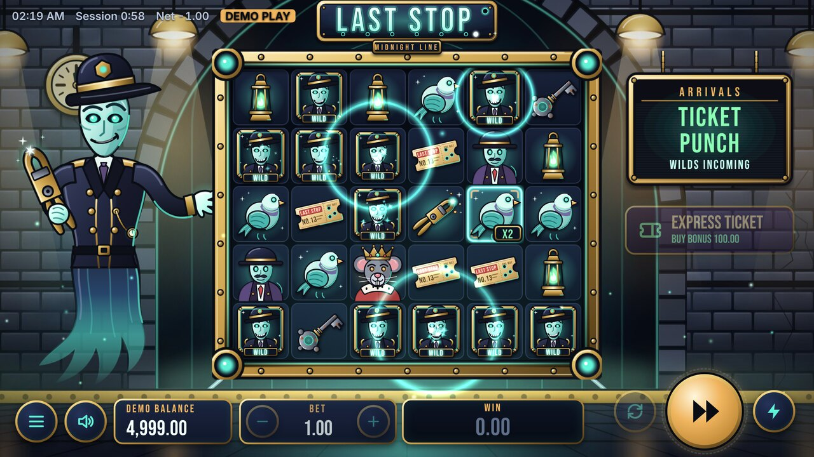

# LAST STOP: Midnight Line

A haunted-subway video slot. 6x5 cluster pays with cascades, haunted multiplier tiles that grow
every time they win, a wild-punching conductor, and a free-spin train ride where the multipliers
never clear. Wins up to 10,000x the bet.



This repository is the complete game: math engine, authoritative game server, browser client,
original art and audio, simulator, tests and documentation.

> **Status.** Built to be handed to a casino platform for integration and certification.
> It is not certified: the RTP figures are this repository's own simulation results, and a
> real-money launch needs an accredited test lab, a platform integration and a jurisdiction
> review. `docs/HANDOFF.md` lists exactly what is done and what is not.

## Quick start

```
npm ci
npm run dev        # offline demo at http://localhost:5173 (play money)
npm test           # engine, RNG, service and HTTP tests
npm run build      # production client in dist/
npm run server     # reference game server on :8787, serves dist/
```

Demo URL parameters: `?profile=demo|eu|uk` picks an operator profile, `?seed=<text>` makes the
offline demo repeatable, `?rgs=<url>&token=<token>` plays against a game server.

## The game

| | |
|---|---|
| Layout | 6 columns x 5 rows, clusters of 5+ pay, winning symbols cascade |
| Phantom Platforms | A Platform Sign haunts its tile (x2). Clusters are multiplied by the sum of the haunted tiles they cover, and those tiles then step up to x4, x8 and on to x128 |
| Ticket Punch | Becomes a Wild and punches 1 to 3 more symbols into Wilds |
| Midnight Train | 3+ Scatters award 10 to 20 free spins in which haunted tiles stay for the whole ride |
| Express Ticket | Optional bonus buy for 100x the bet |
| Maximum win | 10,000x the bet |
| RTP variants | 96.1%, 94.1%, 92.1% (design values; measured results in `docs/PAR_SHEET.md`) |
| Volatility | High |

## How it is built

```
src/math      Engine, math configuration, RNG, statistics, independent round auditor
src/server    Game service (authoritative), wallet port, HTTP reference server
src/shared    Wire protocol and operator configuration, used by both sides
src/client    PixiJS stage, React interface, own animation and audio engines
art/          Vector artwork as code, rendered to public/assets by `npm run art`
scripts/      Simulator, tuner, par sheet generator, art and audio builds
tests/        Vitest suites
docs/         Rules, math, par sheet, integration guide, assets, handoff
```

- **Server authoritative.** The client sends a bet and plays back the finished round it
  receives. The same `GameService` class runs on the server and, for the offline demo, inside
  the page.
- **Exact money.** The engine works in whole coins and every bet is a multiple of the coin, so
  there is no rounding anywhere.
- **Safe under failure.** Outcomes are stored before the wallet is called, requests are
  idempotent, unfinished rounds are restored, history is hash-chained.
- **Operator switches.** Bonus buy, autoplay, turbo, slam stop, minimum game cycle, stake list,
  reality check and on-screen session information are data, enforced on the server.
- **Verifiable math.** One configuration file, a seeded simulator with confidence intervals, and
  an auditor that re-derives every stored round with separate code.

## Documentation

- [Game rules](docs/GAME_RULES.md)
- [Math model](docs/MATH.md) and [par sheet](docs/PAR_SHEET.md)
- [Integration guide](docs/INTEGRATION.md)
- [Assets and provenance](docs/ASSETS.md)
- [Handoff and readiness](docs/HANDOFF.md)

## Verifying the math yourself

```
npm run simulate -- --math LS2-96 --spins 500000000 --buys 10000000
npm run parsheet
```

Play money only in this repository. Nothing here accepts or pays real money.
